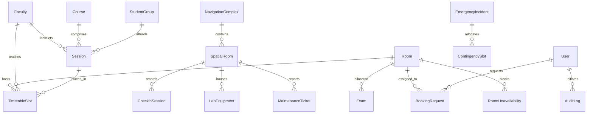

# CIT Nexus – Complete Database Schema Specification

This document details the complete data models, schemas, and relationships of the **CIT Nexus – Smart Campus Intelligence Platform**, which operates on a **dual-datastore architecture**:
1. **SQLite Relational Core (`cit_schedule.db`)**: Enforces referential integrity, mathematical domains, and CP-SAT timetable constraints.
2. **MongoDB Document Store (`cit_smart_campus`)**: Powers spatial navigation, QR check-ins, lab equipment registries, maintenance tickets, and campus emergencies with persistent file fallback.

---

## 1. Entity-Relationship Architecture Diagram



---

## 2. SQLite Relational Schema (`cit_schedule.db`)

### 2.1 Table: `rooms`
Stores campus classrooms, lecture theatres, seminar halls, and laboratories.
| Column | Type | Constraints | Description |
|---|---|---|---|
| `id` | VARCHAR(50) | PRIMARY KEY | Unique room identifier (e.g. `LH-1`, `CR-101`, `CS-LAB-1`) |
| `name` | VARCHAR(100) | NOT NULL | Human-readable room title |
| `building` | VARCHAR(100) | NOT NULL | Building or complex location |
| `type` | VARCHAR(50) | NOT NULL | `lecture_hall`, `classroom`, `lab`, `seminar_hall`, `auditorium` |
| `capacity` | INTEGER | NOT NULL | Maximum seating capacity |
| `features_json` | TEXT | DEFAULT '[]' | JSON array of features (e.g. `["projector", "audio_system"]`) |
| `accessible` | BOOLEAN | DEFAULT FALSE | Wheelchair / step-free accessible indicator |
| `allowed_uses_json` | TEXT | DEFAULT '[]' | Permitted activities (e.g. `["class", "exam", "event"]`) |

### 2.2 Table: `faculty`
Faculty members, contractual teaching constraints, and preferred avoid periods.
| Column | Type | Constraints | Description |
|---|---|---|---|
| `id` | VARCHAR(50) | PRIMARY KEY | Faculty ID (e.g. `F01`, `F02`) |
| `name` | VARCHAR(100) | NOT NULL | Professor full name |
| `department` | VARCHAR(50) | NOT NULL | Academic department (`CSE`, `ECE`, `Mechanical`, `Civil`) |
| `daily_max_hours` | INTEGER | DEFAULT 6 | Hard daily maximum teaching hours |
| `unavailability_json`| TEXT | DEFAULT '[]' | JSON array of leave days and periods |
| `avoid_times_json` | TEXT | DEFAULT '[]' | Soft constraint avoid periods |

### 2.3 Table: `student_groups`
Student cohorts across academic departments and years.
| Column | Type | Constraints | Description |
|---|---|---|---|
| `id` | VARCHAR(50) | PRIMARY KEY | Cohort identifier (e.g. `CSE-1`, `ECE-2`) |
| `name` | VARCHAR(100) | NOT NULL | Full cohort name |
| `department` | VARCHAR(50) | NOT NULL | Department code |
| `size` | INTEGER | NOT NULL | Number of registered students |

### 2.4 Table: `courses`
Academic curriculum offerings.
| Column | Type | Constraints | Description |
|---|---|---|---|
| `id` | VARCHAR(50) | PRIMARY KEY | Course code (e.g. `CS101`, `EC201`) |
| `name` | VARCHAR(150) | NOT NULL | Course title |
| `department` | VARCHAR(50) | NOT NULL | Sponsoring department |
| `semester` | INTEGER | NOT NULL | Academic semester (1 to 8) |

### 2.5 Table: `sessions`
Curricular teaching requirements submitted for scheduling.
| Column | Type | Constraints | Description |
|---|---|---|---|
| `id` | VARCHAR(50) | PRIMARY KEY | Session identifier (e.g. `CS101-LEC`) |
| `course_id` | VARCHAR(50) | FOREIGN KEY -> `courses.id` | Associated course |
| `faculty_id` | VARCHAR(50) | FOREIGN KEY -> `faculty.id` | Assigned instructor |
| `kind` | VARCHAR(50) | NOT NULL | `lecture`, `tutorial`, `lab` |
| `duration` | INTEGER | NOT NULL | Duration in 1-hour periods (1 or 2) |
| `size` | INTEGER | NOT NULL | Expected student enrollment |
| `student_groups_json`| TEXT | NOT NULL | JSON array of cohort IDs attending |
| `allowed_room_types_json`| TEXT | NOT NULL | JSON array of acceptable venue types |
| `needs_accessible` | BOOLEAN | DEFAULT FALSE | Wheelchair accessibility requirement |
| `basket_slot` | VARCHAR(50) | NULL | Open elective basket tag (`OEB-1`, `OEB-2`, `OEB-3`) |

### 2.6 Table: `timetable_slots`
Actual CP-SAT timetable placements committed to the calendar.
| Column | Type | Constraints | Description |
|---|---|---|---|
| `id` | INTEGER | PRIMARY KEY AUTOINCREMENT | Slot record ID |
| `session_id` | VARCHAR(50) | FOREIGN KEY -> `sessions.id` | Scheduled session |
| `day` | VARCHAR(10) | NOT NULL | Day code (`MON`, `TUE`, `WED`, `THU`, `FRI`) |
| `start_period` | INTEGER | NOT NULL | Starting period (1 to 9) |
| `room_id` | VARCHAR(50) | FOREIGN KEY -> `rooms.id` | Allocated classroom or lab |

### 2.7 Table: `exams`
Midsem examination schedules during exam week.
| Column | Type | Constraints | Description |
|---|---|---|---|
| `id` | VARCHAR(50) | PRIMARY KEY | Exam identifier (e.g. `EXAM-CS101`) |
| `course_id` | VARCHAR(50) | FOREIGN KEY -> `courses.id` | Associated course |
| `day` | VARCHAR(10) | NOT NULL | Exam day (`MON`, `TUE`, `WED`, `THU`, `FRI`, `SAT`) |
| `session` | VARCHAR(10) | NOT NULL | Exam block: `AM` (09:30–11:30) or `PM` (14:00–16:00) |
| `room_id` | VARCHAR(50) | FOREIGN KEY -> `rooms.id` | Venue (evaluated at halved capacity) |
| `student_groups_json`| TEXT | NOT NULL | Attending cohorts |
| `size` | INTEGER | NOT NULL | Total exam enrollment |

### 2.8 Table: `booking_requests`
Venue booking requests and status history.
| Column | Type | Constraints | Description |
|---|---|---|---|
| `id` | INTEGER | PRIMARY KEY AUTOINCREMENT | Booking request ID |
| `title` | VARCHAR(150) | NOT NULL | Booking title / description |
| `requester` | VARCHAR(100) | NOT NULL | Submitter name |
| `role` | VARCHAR(50) | NOT NULL | `admin`, `coordinator`, `faculty`, `club` |
| `department` | VARCHAR(50) | NOT NULL | Submitter department |
| `requested_category`| VARCHAR(50) | NOT NULL | `exam`, `regular_session`, `institute_event`, `guest_lecture`, `department_event`, `club_event` |
| `attendance` | INTEGER | NOT NULL | Expected audience size |
| `windows_json` | TEXT | NOT NULL | JSON array of preferred `day` and `periods` |
| `assigned_room` | VARCHAR(50) | NULL | Approved venue |
| `assigned_day` | VARCHAR(10) | NULL | Approved day |
| `assigned_periods` | TEXT | NULL | Approved periods JSON array |
| `status` | VARCHAR(50) | DEFAULT 'pending' | `pending`, `approved`, `rejected`, `alternative_suggested`, `cancelled` |

### 2.9 Table: `room_unavailability`
Maintenance closures and physical room blocks.
| Column | Type | Constraints | Description |
|---|---|---|---|
| `id` | INTEGER | PRIMARY KEY AUTOINCREMENT | Record ID |
| `room_id` | VARCHAR(50) | FOREIGN KEY -> `rooms.id` | Blocked venue |
| `day` | VARCHAR(10) | NOT NULL | Day code |
| `periods_json` | TEXT | NOT NULL | JSON array of blocked periods (e.g. `[1, 2, 3, 4]`) |
| `reason` | VARCHAR(255) | NOT NULL | Maintenance or safety cause |

### 2.10 Table: `audit_logs`
Institutional tamper-evident audit trail.
| Column | Type | Constraints | Description |
|---|---|---|---|
| `id` | INTEGER | PRIMARY KEY AUTOINCREMENT | Log entry ID |
| `timestamp` | DATETIME | DEFAULT UTC NOW | Event timestamp |
| `user_email` | VARCHAR(100) | NOT NULL | Acting user email |
| `role` | VARCHAR(50) | NOT NULL | Acting role |
| `action` | VARCHAR(100) | NOT NULL | Action code (e.g. `GENERATE_TIMETABLE`, `LOCKDOWN`) |
| `target` | VARCHAR(150) | NOT NULL | Target entity |
| `details` | TEXT | NOT NULL | Event summary / payload |

### 2.11 Table: `users`
Authenticated user accounts.
| Column | Type | Constraints | Description |
|---|---|---|---|
| `id` | INTEGER | PRIMARY KEY AUTOINCREMENT | User ID |
| `email` | VARCHAR(100) | UNIQUE, NOT NULL | Account email (login username) |
| `hashed_password` | VARCHAR(255) | NOT NULL | bcrypt salted hash |
| `name` | VARCHAR(100) | NOT NULL | User display name |
| `role` | VARCHAR(50) | NOT NULL | `admin`, `department_coordinator`, `faculty`, `club` |
| `department` | VARCHAR(50) | NOT NULL | Assigned department |

---

## 3. MongoDB Document Schemas (`cit_smart_campus`)

### 3.1 Collection: `cit_campus_navigation`
Stores complex metadata, 2D coordinates, and floor spatial positioning:
```json
{
  "_id": "6724a1b0...",
  "type": "campus_metadata",
  "institute": "Chilika Institute of Technology",
  "buildings": [
    {
      "building_id": "MAIN-ACADEMIC",
      "name": "Main Academic Complex",
      "code": "MAC",
      "floors": 4,
      "has_elevator": true,
      "accessible_ramps": true,
      "coordinates": { "lat": 20.1485, "lng": 85.6710 },
      "departments": ["CSE", "ECE", "Dean's Office"]
    }
  ],
  "rooms": [
    {
      "room_id": "LH-1",
      "name": "Lecture Hall 1",
      "building": "MAIN-ACADEMIC",
      "floor": 1,
      "wing": "East",
      "accessible": true,
      "type": "lecture_hall",
      "capacity": 120,
      "x": 120,
      "y": 80
    }
  ]
}
```

### 3.2 Collection: `cit_classroom_checkins`
Stores dynamic QR check-in records and actual room headcount:
```json
{
  "_id": "6724a2e1...",
  "qr_token": "CIT-QR-LH-1-K89J2",
  "room_id": "LH-1",
  "attendee_id": "faculty@cit.edu",
  "actual_headcount": 104,
  "checkin_time": "2026-11-01T09:05:00Z",
  "status": "checked_in"
}
```

### 3.3 Collection: `cit_lab_equipment`
Scientific apparatus inventory, technical specifications, and reservation records:
```json
{
  "_id": "6724a3f4...",
  "equipment_id": "EQ-GPU-01",
  "name": "NVIDIA DGX A100 AI Compute Node",
  "room_id": "CS-LAB-1",
  "lab_name": "Computing Science Lab 1",
  "department": "CSE",
  "status": "available",
  "specifications": "8x A100 80GB SXM4, 1.2TB NVMe scratch storage",
  "power_rating_kw": 6.5,
  "reservations": [
    {
      "reservation_id": "RES-EQ-GPU-01-1",
      "user_email": "faculty@cit.edu",
      "project_or_course": "CS401 Deep Learning Capstone",
      "day": "WED",
      "periods": [6, 7, 8],
      "status": "confirmed"
    }
  ]
}
```

### 3.4 Collection: `cit_maintenance_tickets`
Tracks infrastructure repair requests and links automatically to `RoomUnavailability`:
```json
{
  "_id": "6724a4d2...",
  "ticket_id": "TICK-LH-1-173000",
  "room_id": "LH-1",
  "title": "HVAC Compressor Overheat",
  "category": "hvac",
  "severity": "Critical",
  "requires_closure": true,
  "unavailability_id": 42,
  "day": "Friday",
  "periods": [1, 2, 3],
  "assigned_to": "Debashis Sahoo (HVAC Specialist)",
  "reporter_email": "admin@cit.edu",
  "status": "assigned",
  "resolution_notes": null,
  "created_at": "2026-10-31T10:15:00Z"
}
```

### 3.5 Collection: `cit_academic_calendar`
Stores milestones, festival dates, and calendar alert rules:
```json
{
  "_id": "6724a5b3...",
  "type": "calendar_milestone",
  "event": "Spectra '27 Annual Technical & Cultural Fest",
  "date": "2026-11-16",
  "week": "Week 7",
  "category": "Festival",
  "days_remaining": 15
}
```

### 3.6 Collection: `cit_green_energy`
Power consumption parameters and hourly sustainability coefficients:
```json
{
  "_id": "6724a6e8...",
  "room_id": "LH-1",
  "hvac_kw_per_seat": 0.035,
  "lighting_kw_per_seat": 0.008,
  "auxiliary_base_kw": 2.5,
  "grid_emission_factor_kg_co2_per_kwh": 0.72
}
```

### 3.7 Collection: `cit_emergency_incidents`
Records emergency lockdown declarations, affected roster impact, and contingency relocate proposals:
```json
{
  "_id": "6724a7a9...",
  "incident_id": "EMERG-INNOVATION-WORKSHOPS-173000",
  "title": "Electrical Transformer Maintenance Lockdown",
  "severity": "HIGH",
  "scope": "building",
  "target_building": "INNOVATION-WORKSHOPS",
  "closed_rooms": ["PROJECT-LAB-1", "PROJECT-LAB-2", "MECH-WORKSHOP", "CAD-CAM-LAB"],
  "reason": "Precautionary power cut for electrical transformer maintenance",
  "affected_classes_count": 6,
  "affected_cohorts": ["ME-Year3", "ME-Year4"],
  "affected_faculty": ["Dr. D. Sahoo", "Prof. R. Mishra"],
  "contingency_status": "published_approved",
  "status": "active_lockdown",
  "created_at": "2026-10-31T14:30:00Z"
}
```
